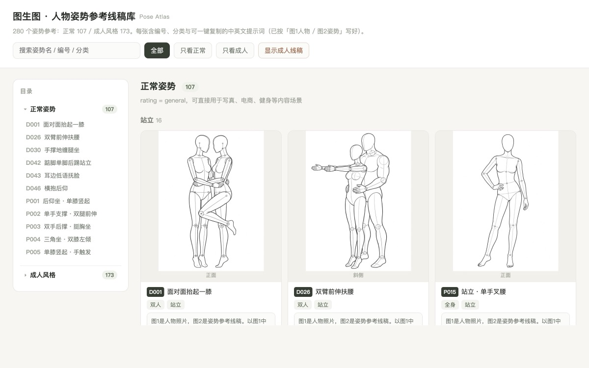
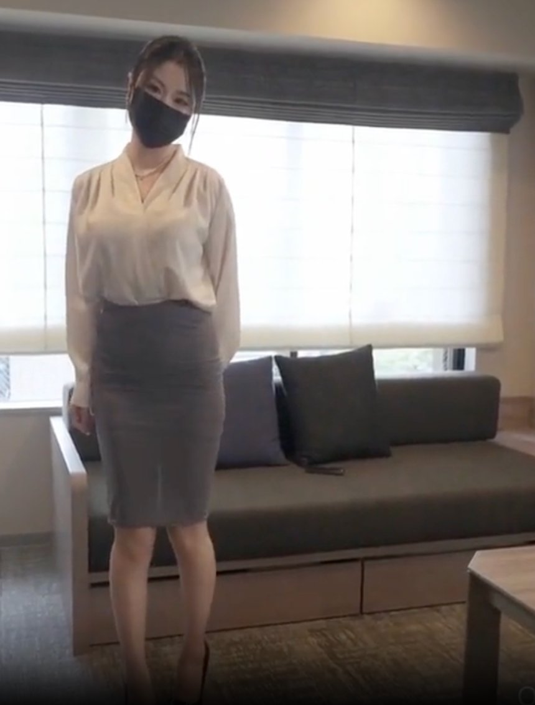
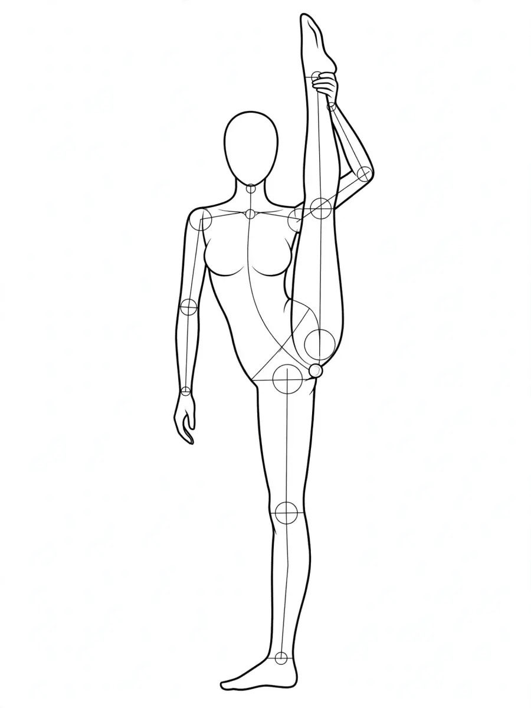
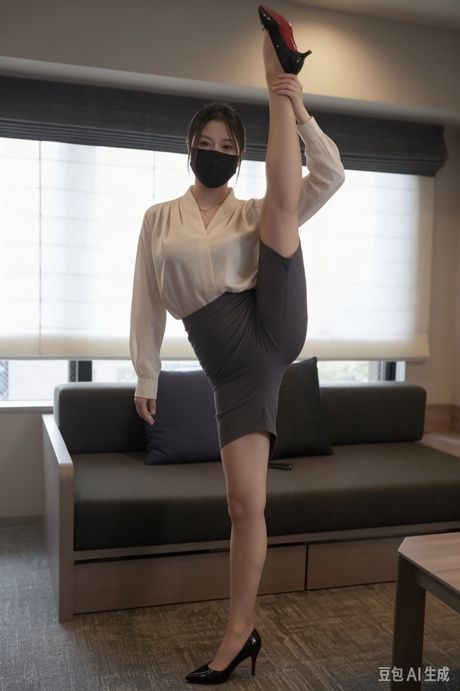
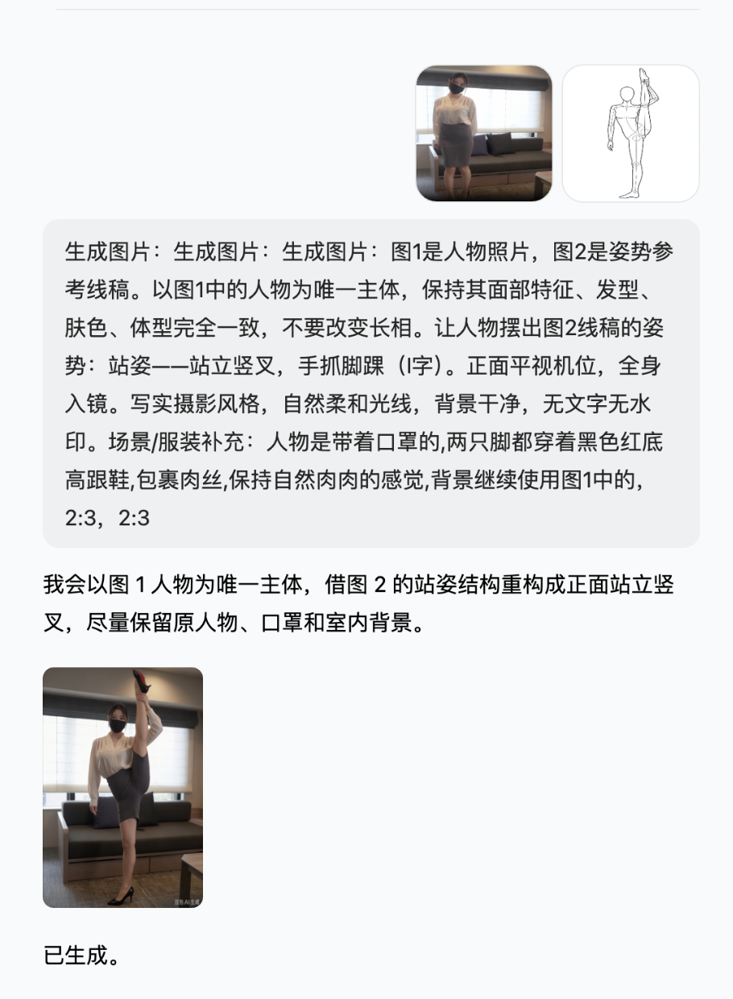

# Pose Atlas · Pose Reference Library

<sub>图生图 · 人物姿势参考线稿库 · 280 pose reference sheets</sub>

English | [简体中文](README.md)

[](LICENSE)
[](#whats-inside)
[](index.html)

**280 pose reference sheets**, each with an ID, a category and a copy-ready prompt. Pick a pose line art, pair it with a photo of your character, and the same person shows up in that pose — for pose-guided image-to-image, character sheets, storyboards and more.

> 280 张人物姿势线稿：选一张姿势、配一张人物照片，让同一个人摆出任意姿态（页面与提示词均支持中英文）。



How to browse: download the repo and open [`index.html`](index.html) in the root — pure static, double-click to view, no backend, no dependencies, no build step. The page has a **中/EN toggle** in the top-right corner.

## What's inside

| Bucket | Count | Notes |
|---|--:|---|
| General `normal/` | 107 | Sitting, standing, kneeling, lying, two-person shots — safe for portraits, e-commerce, fitness |
| Stylized / adult `adult/` | 173 | More suggestive poses; blurred by default, click "Reveal adult art" to view |

Each pose card includes:

- **ID + name**, e.g. `D042-踮脚单脚后踢站立`
- **Category & series** (full body / half body / stylized / two people; sitting, standing, lying…)
- **Pose line art** (mannequin on white — feed it straight to your model as the reference image)
- **A ready-made Chinese prompt**, already phrased as "image 1 = your photo, image 2 = pose sheet", one-click copy
- **An English prompt** for GPT-Image and other English-first models
- Line-art download

The left sidebar is a **two-level table of contents** (bucket → ID + pose name); click an entry to jump to its card. The top bar has search and General / Adult filters.

## Use cases

| Scenario | How this library helps |
|---|---|
| AI pose transfer / image-to-image | one photo + one pose sheet: keep the face, change the pose |
| Portrait sessions, e-commerce model shots | pick standing / sitting poses, batch-generate with scene descriptors |
| Character design, comic storyboards | same character across many poses, fast composition alignment |
| Fitness / yoga / dance reference | big-motion poses as visual reference |
| Learning prompt writing | bilingual + structured templates you can copy as-is |

## How to use

### Doubao / Jimeng (Chinese apps)

1. Tap `＋` in the chat box and attach **two** images: **your photo first (image 1)**, **the pose sheet second (image 2)**
2. Paste the prompt from the card, append a scene / outfit description at the end
3. Aspect ratio 2:3 portrait → send

> Doubao has no "character reference" toggle — it relies on multiple images plus explicitly numbering their roles in the prompt. Always write "image 1" and "image 2" clearly, or the model may merge both images into one person.

### GPT-Image / other APIs

Submit the same pose sheet as the second reference image of `images/edits` (pass both the photo and the sheet via `image[]`).

## Example

<table>
  <tr>
    <td align="center"><br><sub>Image 1 · your photo</sub></td>
    <td align="center"><br><sub>Image 2 · pose sheet</sub></td>
    <td align="center"><br><sub>Result (Doubao)</sub></td>
  </tr>
</table>

A real run (Doubao, S008 standing split): face, outfit and background preserved; only the pose is rebuilt.

The actual Doubao conversation — both images attached, prompt copied from the card, generated in one shot:



## Repository layout

```
.
├── index.html        # gallery page (TOC + card wall + copy-ready prompts, 中/EN toggle)
├── normal/           # 107 general pose line arts (webp)
├── adult/            # 173 stylized / adult line arts (webp)
├── docs/images/      # example images
├── README.md         # 简体中文说明
├── README.en.md      # this file
└── LICENSE
```

## Notes

- Everything in this repo is released under the **Apache License 2.0** — free to use, modify, distribute and commercialize (with an explicit patent grant); just keep the [LICENSE](LICENSE) and copyright notice when redistributing.
- Generating images of real people requires their consent (portrait rights); label AI-generated content as required by your local regulations.
- Mainstream models generally refuse "real-person photo + suggestive pose" requests — that's platform policy, not a limitation of this library.

## License

[Apache License 2.0](LICENSE) — **fully open**. Page code, structure, all 280 pose line arts and the prompt templates are free to use, modify, distribute and commercialize, with an explicit patent grant. The only requirement is keeping the license and copyright notice when redistributing.

---

<sub>Keywords: pose reference · pose library · pose sheet · figure drawing reference · image-to-image · pose transfer · character sheet · prompt template · AI art reference · Doubao · Jimeng · GPT-Image · Stable Diffusion · 姿势参考 · 图生图 · 换姿势</sub>
