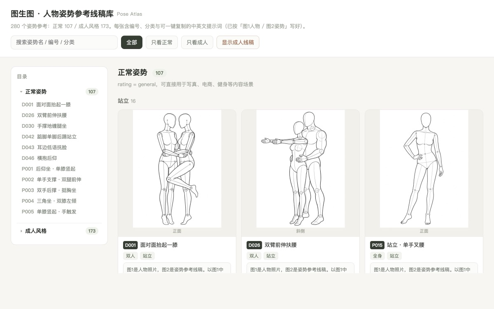
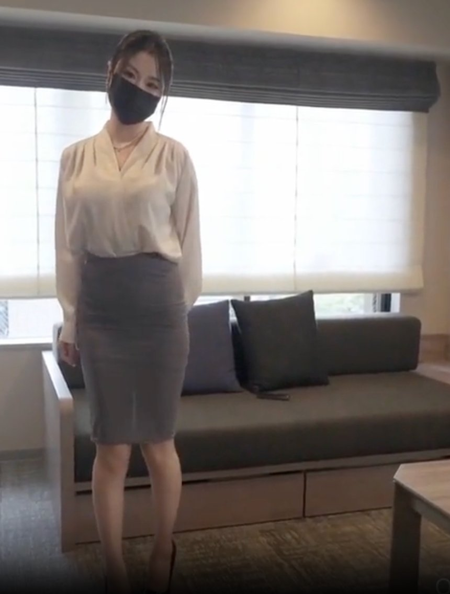
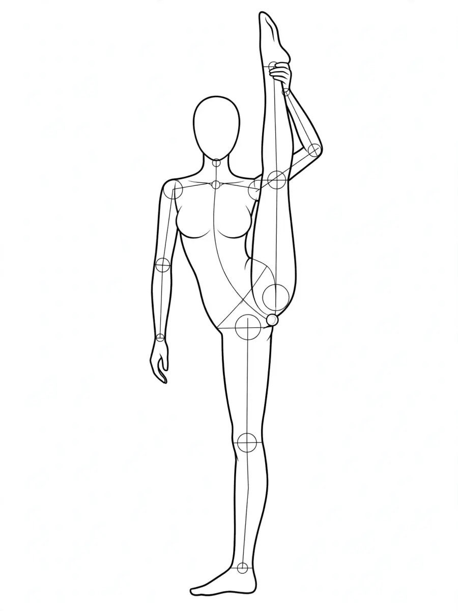
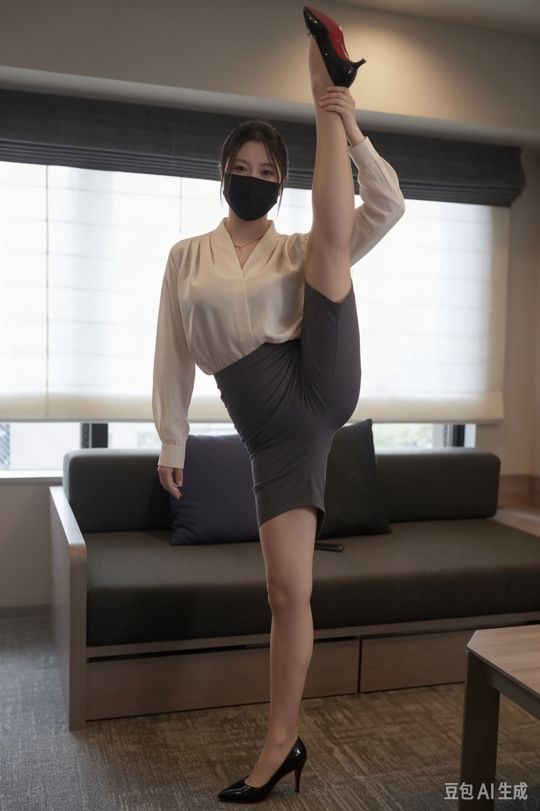
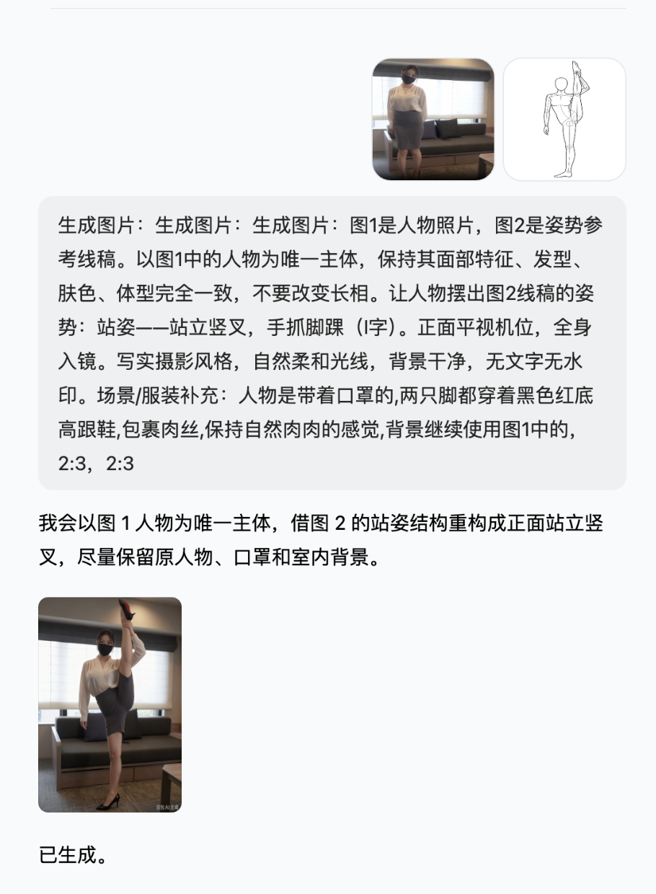

# 姿态图鉴 · Pose Atlas

> 280 个人物姿势参考图，每个都配好编号、分类和可直接复制的提示词。选一张线稿，配上你的人物照片，就能让 TA 摆出任意姿态。



**[→ 在线浏览](https://zg-405.github.io/pose-studio-lite/)** ｜ 也可以下载后直接打开根目录的 [`index.html`](index.html)（纯静态，双击即看，无后端、无依赖、无需构建）

## 里面有什么

| 大类             |  数量 | 说明                            |
| -------------- | --: | ----------------------------- |
| 正常姿势 `normal/` | 107 | 坐、站、跪、躺、双人合影等，适合写真、电商、健身等内容场景 |
| 成人风格 `adult/`  | 173 | 姿态更具暗示性，页面默认模糊，点右上角「显示成人线稿」查看 |

每个姿势卡片包含：

- **编号 + 中文名**，如 `D042-踮脚单脚后踢站立`
- **分类与系列**（全身 / 半身 / 风格 / 双人；坐姿、站姿、躺姿…）
- **姿势线稿**（木偶人，白底线条，可直接当参考图喂给模型）
- **现成中文提示词**，已按「图1=人物照片、图2=姿势线稿」写好，一键复制
- **英文提示词**，喂 GPT-Image 等英文模型用
- 线稿下载

页面左侧是**两层目录**（大类 → 编号-姿势名），点条目直接跳到对应卡片；顶部可搜索、可按「只看正常 / 只看成人」筛选。

## 怎么用

### 豆包 / 即梦

1. 对话框点 `＋`，一次传两张：**先传你的人物照片（图1）**，**再传这里的线稿（图2）**
2. 粘贴卡片里的中文提示词，末尾补一句场景/服装
3. 比例选 2:3 竖版 → 发送

> 豆包没有「人物参考」开关，靠多图 + 提示词里的编号点名用途，一定要写清「图1」「图2」，否则容易把两张图混成一个人。

### GPT-Image / 其他 API

同一套线稿与提示词，作为 `images/edits` 的第二张参考图提交即可（`image[]` 放人物照和线稿两张）。

## 效果示例

<table>
  <tr>
    <td align="center"><br><sub>图1 · 人物照片</sub></td>
    <td align="center"><br><sub>图2 · 姿势线稿</sub></td>
    <td align="center"><br><sub>生成结果（豆包）</sub></td>
  </tr>
</table>

一次真实使用（豆包，S008 站立竖叉）：保持人脸、服装、背景一致，仅重构姿势。

豆包里的实际对话——两张图一起传，复制本库卡片里的提示词，一次生成：



## 目录结构

```
.
├── index.html        # 总览页（目录 + 卡片墙 + 复制提示词）
├── normal/           # 正常姿势线稿 107 张（webp）
├── adult/            # 成人风格线稿 173 张（webp）
├── docs/images/      # 效果示例图
├── README.md
└── LICENSE
```

## 说明

- 线稿素材来自第三方姿势库，**仅作学习与研究参考，版权归原作者**；商用请自行创作（3D 人偶渲染 / 手绘 / OpenPose 骨骼图）或取得授权。
- 用他人照片生成图像需取得肖像权授权；生成内容请依规添加 AI 生成标识（见《人工智能生成合成内容标识办法》）。
- 主流模型对「真人照片 + 性暗示姿势」类请求普遍会拒绝，属平台策略，与库本身无关。

## License

页面代码（HTML / CSS / JS）以 MIT 发布，见 [LICENSE](LICENSE)；姿势线稿素材不在授权范围内。
